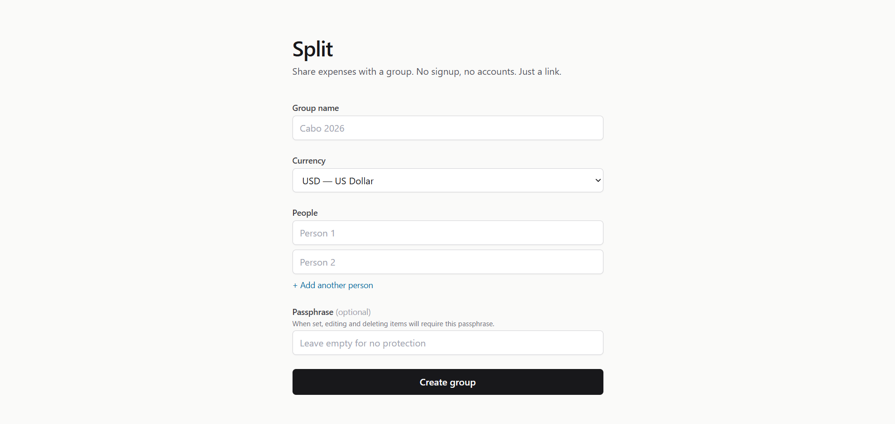

# Split

**Track shared expenses without the hassle.**

Split is a dead simple group expense tracker. No accounts, no sign ups, no app to download. Just create a group, share the link, and start logging who paid for what. The app figures out who owes whom and gives you the fewest transfers needed to settle up.

Built for travel groups, roommates, dinner tabs, or any situation where people split costs.

[**Try it live**](https://split-james-potekev.vercel.app/)

## How it works

1. **Create a group** with the people involved and pick a currency
2. **Log expenses** as they happen, noting who paid and how to split
3. **Settle up** when you're done. Split calculates the minimum number of transfers

That's it. Everyone with the link can see and add expenses.

## Quick example

Say you and a friend are road tripping to Albuquerque, New Mexico.

1. Go to [split-james-potekev.vercel.app](https://split-james-potekev.vercel.app/)
2. Name your group something like **"Albuquerque Road Trip"**
3. Add **Walter White** and **Gus Fring** as members
4. Pick **USD** as the currency and hit **Create group**

Now start logging expenses:

- Walter pays $120 for the motel: add it, split equally
- Gus pays $45 for dinner: add it, split equally
- Walter pays $60 for gas: add it, split equally

When you're done, open the **Settle Up** tab. Split will tell you Gus owes Walter $37.50 and you're square. One transfer instead of three.

## Features

- **No accounts required.** Access your group via a private link
- **Multi-currency support.** 30+ currencies with correct minor unit handling (no floating point nonsense)
- **Flexible splitting.** Equal, exact amounts, or percentages
- **Minimum transfers.** The settle-up algorithm finds the fewest payments to zero everyone out
- **Passphrase protection.** Optionally lock edits and deletes behind a passphrase
- **Works offline.** Expenses queue up and sync when you're back online
- **Mobile friendly.** Works great on a phone, which is where you'll use it

## Tech stack

Next.js 14, TypeScript, Prisma, Neon Postgres, Tailwind CSS. Deployed on Vercel.
